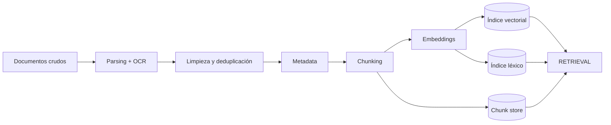

---
tags:
  - rag
  - rag/pipeline
  - rag/fase/chunking
aliases:
  - Chunking
  - CHUNKING
---
# Fase 1 · Chunking

> [!info] Propósito
> También llamada Indexing: convertir un corpus heterogéneo en una estructura consultable: chunks con significado, vectores comparables y metadata que permita filtrar y autorizar.

> [!tip] Analogía dev
> Es un ETL + indexing. Parseás fuentes, normalizás, particionás en registros y construís un índice, igual que preparar una tabla para consultas rápidas.

## Diagrama de la fase

## Contrato de entrada y salida

> [!info] Entrada — Documentos crudos
> - PDF, HTML, Markdown, DOCX, PPTX
> - Filas de base de datos, tickets, transcripciones
> - Código fuente e imágenes escaneadas
> - Cada fuente con su parser y su ruido

> [!success] Salida — Índice consultable
> - Índice vectorial ANN (HNSW / IVF / PQ)
> - Índice léxico BM25 / SPLADE (opcional)
> - Chunk store: texto + metadata + parent_id
> - Configuración versionada (embedder, chunk_size, overlap)

## Salida en detalle

La salida no es un solo objeto: es un paquete de artefactos que trabajan juntos. Cada uno resuelve una parte distinta de la búsqueda y tiene un consumidor concreto en RETRIEVAL.

### Índice vectorial

`ANN · HNSW · IVF · PQ`

Guarda un vector por chunk y permite responder rápido «¿qué chunks se parecen a este vector?». No compara contra todos: usa una estructura aproximada para encontrar vecinos cercanos.

- **Función**: Es el motor de la búsqueda semántica. RETRIEVAL convierte la query en un vector y le pide los vecinos más cercanos.
- **Conecta con**: Sin este índice, RETRIEVAL tendría que recorrer todos los chunks en cada pregunta. HNSW usa un grafo, IVF agrupa en clusters y PQ comprime los vectores para ahorrar memoria.

> [!tip] Analogía dev
> Como un mapa organizado por zonas: llegás a la zona correcta sin revisar calle por calle.

### Índice léxico

`BM25 · SPLADE`

Indexa palabras y términos exactos. Encuentra coincidencias literales que la búsqueda semántica puede pasar por alto.

- **Función**: Se consulta en paralelo al índice vectorial (búsqueda híbrida). Es clave para nombres propios, códigos, siglas y números.
- **Conecta con**: RETRIEVAL fusiona ambos rankings antes del reranking. BM25 es el clásico; SPLADE es léxico neural con expansión de términos.

> [!tip] Analogía dev
> Como el índice alfabético de un libro: si sabés la palabra exacta, es el camino más directo.

### Chunk store

`texto + metadata + parent_id`

Es la base donde vive el contenido real de cada chunk: el texto, sus datos y el vínculo con su documento padre.

- **Función**: El índice devuelve IDs y scores; el chunk store resuelve el texto que se inserta en el prompt. La metadata permite filtrar por tenant, ACL o fecha; parent_id permite traer el contexto completo.
- **Conecta con**: AUGMENTED consume el texto y la metadata para construir el prompt y el citations_map.

> [!tip] Analogía dev
> Como la ficha completa de un registro: el índice te da el ID y el store te da el contenido.

### Configuración versionada

`embedder · chunk_size · overlap`

Es el «cómo se construyó»: qué modelo convirtió texto en vectores, con qué tamaño de chunk y cuánto solapamiento entre fragmentos.

- **Función**: Hace reproducible el índice. Si cambia el embedder, los vectores nuevos y viejos no son comparables: hay que reindexar todo.
- **Conecta con**: RETRIEVAL debe usar el mismo embedder para la query; la auditoría necesita saber qué versión produjo cada respuesta.

> [!tip] Analogía dev
> Como el lockfile de dependencias: sin la versión exacta, el build no es reproducible.

## Chunking en profundidad

De strings a vectores: qué significa una dimensión, cómo se mide la distancia, cómo fluye la ingesta y por qué un bi-encoder no es un LLM.

### Embeddings: vectores, dimensiones y espacios N-dimensionales

El chunking corta texto; el modelo de embeddings lo convierte en coordenadas. Estas coordenadas son las que después se buscan.

**Chunking** —también llamado **Indexing**— es la fase en la que partimos los documentos en fragmentos (**chunks**) de distinta longitud, según cuánto texto queremos pasarle al modelo. Después esos chunks pasan a un **entorno vectorial** conocido como **embeddings** y se guardan en una base de datos vectorial, o en una base que tenga soporte para vectores. Cuando hacemos una pregunta, buscamos ahí y traemos los fragmentos más parecidos. En términos de desarrollo: parseamos las fuentes, las normalizamos, las particionamos en registros y construimos un índice, igual que preparar una tabla para consultas rápidas.

El **chunking** es una operación sobre texto: parte un documento en fragmentos llamados **chunks**. Recién después, un **modelo de embeddings** toma cada chunk y lo transforma en un vector numérico de **N dimensiones**. Los textos con significado similar terminan cerca en el espacio vectorial; esa cercanía es la que usa el retrieval.

La idea es imaginar un **mapa**: cada embedding es una coordenada y los conceptos parecidos quedan próximos. Esa proximidad se mide con una fórmula de distancia o similitud.

El gato duerme en el sofá

`[0.12, -0.34, 0.87, …]`

Un felino descansa en el mueble

`[0.11, -0.33, 0.85, …]`

Python es un lenguaje de programación

`[-0.45, 0.72, 0.01, …]`

> [!note]
> **Resumen:** un embedding es una lista de números reales que representa un concepto —palabra, frase, imagen— como un único punto o dirección dentro de un espacio matemático. Aunque tenga 1.536 dimensiones, en código sigue siendo un **vector 1D**: se recorre con un solo índice, `vector[i]`.

#### 1.1.1 La gran confusión: dos significados de “dimensión”

Cuando decimos que un embedding es un “vector de N dimensiones”, solemos pensar que a partir de 2 dimensiones debería ser una matriz. La clave está en distinguir qué significa **dimensión** según la disciplina:

Álgebra lineal y geometría

#### Dimensión del espacio

Es la **cantidad de coordenadas o ejes** que necesitamos cruzar para ubicar un único punto.

- 2 números `(x, y)` → espacio de 2 dimensiones (ℝ²).
- 3 números `(x, y, z)` → espacio de 3 dimensiones (ℝ³).
- 1.536 números `(x₁, x₂, …, x₁₅₃₆)` → espacio de 1.536 dimensiones (ℝ¹⁵³⁶).

Programación y datos

#### Rango o ejes del tensor

Es la **cantidad de índices independientes** que necesitamos para acceder a un dato: `array[i]` frente a `array[i][j]`.

- Un embedding individual → `array[i]` → 1D.
- Un lote de embeddings → `matriz[fila][columna]` → 2D.
- Secuencias por lotes → `tensor[b][t][d]` → 3D.

#### 1.1.2 Tabla de equivalencias: álgebra vs. código

| Concepto matemático | Representación en código | Rango / ejes | Shape | Cómo se indexa |
| --- | --- | --- | --- | --- |
| **Escalar** | Un único número (`42`) | `0D` | `()` | `valor` |
| **Vector (1 embedding)** | Lista de números (`[0.1, -0.4, 0.8]`) | `1D` | `(1536,)` | `vector[i]` |
| **Matriz (batch de embeddings)** | Tabla de filas y columnas | `2D` | `(32, 1536)` | `matriz[fila][columna]` |
| **Tensor 3D** | Cubo de datos, por ejemplo secuencias por lotes | `3D` | `(8, 32, 1536)` | `tensor[b][t][d]` |

> [!note]
> **Regla de oro:** cantidad de elementos del array = cantidad de dimensiones matemáticas = cantidad de coordenadas de ese único punto. Un embedding individual **nunca es una matriz por sí solo**; se vuelve matriz cuando agrupamos varios vectores, por ejemplo 32 embeddings de 1.536 dimensiones forman una matriz de `32 × 1536`.

#### 1.1.3 ¿Por qué N coordenadas siguen siendo un solo punto?

Cada posición del vector es una **característica latente** (*feature*) que actúa como un eje del mapa que ubica un concepto. Por ejemplo, para la palabra “Perro”:

1D · 1 eje

#### ¿Es un ser vivo?

`[0.9]` es un punto sobre una línea recta.

2D · 2 ejes

#### ¿Vivo? ¿Doméstico?

`[0.9, 0.8]` es un único punto en una hoja de papel. Los dos números no son dos puntos: son las instrucciones para clavar un solo alfiler.

3D · 3 ejes

#### ¿Vivo? ¿Doméstico? ¿Tamaño?

`[0.9, 0.8, 0.5]` es un punto flotando en una habitación, o una flecha desde el origen `(0,0,0)` hasta ese punto.

ND · N ejes

#### Cuando se acaban X, Y, Z

Se usan subíndices: `(x₁, x₂, …, x₁₀₀)`. En código es `vector[0]`, `vector[1]`, …, `vector[99]`. Todas esas coordenadas juntas ubican **un solo concepto**.

> [!info] Simulador interactivo
> SIMULADOR 01 Laboratorio de embeddings y dimensiones Vector vs. matriz, distancia euclidiana vs. coseno, coordenadas paralelas y proyección 200D → 3D. Arrastrá los lienzos 3D para rotar la cámara. Usá las pestañas para cambiar entre vector/matriz, distancias, N dimensiones y proyección.
>
> Disponible en la app: fase Chunking.

### Distancias y similitud entre vectores

Tres fórmulas que funcionan igual en 3D, 100D o 1.536D: distancia euclidiana, similitud del coseno y producto punto.

Si tenemos estos tres vectores de 3 dimensiones, a simple vista **A y B están casi pegados** y **C está muy lejos**:

Vector A

`[0.13, 0.25, 0.99]`

Vector B

`[0.11, 0.23, 0.90]`

Vector C

`[-3.00, 0.10, 1.00]`

En motores de búsqueda vectorial como **Qdrant, Pinecone, Milvus o pgvector**, esa cercanía se mide con tres fórmulas que funcionan exactamente igual en 3D, 100D o 1.536D.

1.1.5 · La regla física

#### Distancia euclidiana (L2)

Es el teorema de Pitágoras generalizado a N dimensiones. Mide la línea recta entre las puntas de dos vectores.

$$
d(A,B) = \sqrt{\sum_i (A_i - B_i)^2}
$$

- **A vs. B:** ≈ **0.094** → muy cercanos, próximo a 0.
- **A vs. C:** ≈ **3.133** → muy lejanos.

1.1.6 · El ángulo de la brújula

#### Similitud del coseno

En vez de medir la distancia entre puntas, mide el **ángulo θ** entre las dos flechas que salen del origen. Es el estándar en NLP porque captura significado sin importar la longitud del texto.

$$
\cos(\theta) = \frac{A \cdot B}{\lVert A \rVert \, \lVert B \rVert}
$$

- **A vs. B:** ≈ **0.9998** → casi idénticos.
- **A vs. C:** ≈ **0.1890** → ángulo muy abierto, baja relación.
- Rango: **−1** (opuestos, 180°) → **0** (ortogonales, 90°) → **1** (misma dirección, 0°).

1.1.7 · El atajo de alta velocidad

#### Producto punto (dot product)

Multiplica coordenada por coordenada y suma todo:

$$
A \cdot B = \sum_i A_i B_i
$$

> [!note]
> **Truco en producción:** cuando los embeddings están **normalizados** —su magnitud ‖A‖ es exactamente 1—, el denominador del coseno se vuelve `1 × 1 = 1`. Entonces el producto punto da exactamente el mismo resultado que la similitud del coseno, y ahorra millones de raíces cuadradas y divisiones en la GPU.

> [!note]
> En el **Simulador 01**, pestaña **“Distancias (Euclidiana vs. Coseno)”**, podés mover las coordenadas y ver las dos métricas actualizarse en vivo.

### El flujo real: ingesta vs. consulta

El chunking no vectoriza: solo corta strings. La vectorización ocurre después, en un modelo de embeddings especializado.

La conversión de texto a embeddings se hace exclusivamente con un **modelo de embeddings especializado**. Es clave separar las dos etapas: el chunking corta el texto en fragmentos (**strings**) y recién después el modelo toma cada fragmento y lo transforma en un vector de **N dimensiones**.

1

#### Dividir el documento

Un *text splitter* —por ejemplo `RecursiveCharacterTextSplitter`— toma un documento largo (PDF, Markdown, código) y lo corta en fragmentos, por ejemplo de **500 tokens** con un **overlap** de **50 tokens** para no cortar ideas por la mitad.

El resultado es una lista de strings: `["chunk 1…", "chunk 2…", "chunk 3…"]`.

2

#### Vectorizar los chunks

La lista se envía en *batch* a un modelo de embeddings como `text-embedding-3-small`, `bge-m3` o `nomic-embed-text`.

Cada chunk produce **exactamente un vector**. Si enviamos 10 chunks a un modelo de 1.536 dimensiones, recibimos una **matriz de 10 × 1.536**: son 10 vectores agrupados, no un vector de 10 dimensiones.

3

#### Indexar en la base vectorial

En Qdrant, Pinecone, pgvector o Milvus se guarda cada registro con tres elementos inseparables:

- `id` : identificador único del fragmento.
- `vector` : el arreglo numérico que se usa para calcular distancias.
- `payload` / `metadata` : el texto plano original, el nombre del archivo y la página. Los vectores no se pueden “desencriptar” de vuelta a texto.

4

#### Consultar y recuperar

La pregunta del usuario pasa por el **mismo modelo de embeddings** y se convierte en un *query vector*. La base calcula la similitud del coseno contra los vectores guardados, recupera los **K más cercanos** y le pasa sus textos originales al LLM para que redacte la respuesta.

> [!note]
> **CRÍTICO:** se debe usar exactamente el mismo modelo de embeddings en la ingesta y en la consulta. Si cambia el modelo, cambia la geometría del espacio y el recall se cae sin dar ningún error visible.

> [!info] Simulador interactivo
> SIMULADOR 02 Pipeline RAG: inspección de datos paso a paso Documento crudo → chunking → embeddings → vector DB → similitud y retrieval. Avanzá con “Siguiente” o hacé click en los nodos del diagrama para ver el input y el output de cada etapa.
>
> Disponible en la app: fase Chunking.

### Modelo de embeddings vs. LLM generativo

Los dos nacen de Transformer, pero cumplen roles opuestos: representar significado vs. predecir el siguiente token.

Aunque ambos nacen de la arquitectura **Transformer**, un modelo de embeddings y un LLM generativo no hacen lo mismo. Uno comprime significado en coordenadas; el otro produce texto nuevo token por token.

| Característica | Modelo de embeddings (encoder / bi-encoder) | LLM generativo (decoder) |
| --- | --- | --- |
| **Objetivo** | Comprimir y representar significado en coordenadas fijas. | Predecir el siguiente token: generar texto nuevo. |
| **Cómo lee el texto** | **Bidireccional:** lee todo el chunk al mismo tiempo para entender el contexto completo antes del *pooling*. | **Unidireccional / causal:** lee de izquierda a derecha, palabra por palabra. |
| **Entrada → salida** | `String` (chunk) → `float[N]` (por ejemplo, 1.536 números). | `String` (prompt) → `String` (respuesta). |
| **Ejemplos** | `text-embedding-3-small`, `text-embedding-004`, `BAAI/bge-m3`, `nomic-embed-text`. | `GPT-4o`, `Claude 3.5 Sonnet`, `Gemini 2.5 Pro`, `Llama 3`. |

> [!note]
> **Regla de oro en RAG:** nunca se pueden mezclar modelos. Si indexamos los chunks con un modelo de OpenAI de 1.536 dimensiones y convertimos la pregunta con un modelo local como `bge-m3` de 1.024 dimensiones, no solo falla por la cantidad de coordenadas: incluso si ambos tuvieran 768 dimensiones, cada modelo organiza su “mapa geométrico” de forma totalmente distinta.

### Encoder, bi-encoder y cross-encoder

La diferencia no es el archivo que descargás: es el diseño de la arquitectura y el momento en que se cruzan la pregunta y el documento.

Son modelos de Machine Learning basados en Transformer, pero entrenados de formas distintas. La confusión suele venir de que llamamos “modelo” al archivo que descargamos; la diferencia entre un **bi-encoder** y un **cross-encoder** está en cómo procesan la información y en qué momento se cruzan la pregunta y el documento.

Se usan para cosas complementarias dentro de un RAG: el bi-encoder para **recuperar** y el cross-encoder para **reordenar**.

#### ¿Por qué se les llama “encoders”?

Vienen de la arquitectura original del Transformer, que tenía dos partes: el *encoder* que leía y entendía el texto, y el *decoder* que lo generaba, como GPT.

- El **bi-encoder** usa dos encoders independientes —de ahí “bi”—.
- El **cross-encoder** usa un solo encoder que cruza ambos textos internamente desde la primera capa.

Por eso, cuando configuramos un RAG, descargamos dos modelos distintos según la fase: un **bi-encoder** para generar y guardar los embeddings, y opcionalmente un **cross-encoder** —normalmente llamado *reranker*, como `bge-reranker-large`— para afinar los resultados al final.

Bi-Encoder · “El separado”

#### Dos textos, dos vectores

Es un modelo de lenguaje —un encoder como BERT, RoBERTa o un modelo especializado de Hugging Face— al que le pasamos un texto y devuelve un vector numérico. Lo descargamos, por ejemplo `bge-small-en-v1.5`, y lo ejecutamos localmente o vía API.

Cómo funciona

Toma la pregunta por un lado y el documento por el otro, y los procesa de forma totalmente independiente. El resultado son **dos vectores separados**.

Cuándo se cruzan

No se cruzan dentro de la red. La relación se calcula al final con una fórmula rápida: similitud del coseno o producto punto entre los vectores ya terminados.

Ventaja

Como los documentos no necesitan conocer la pregunta de antemano, podés precalcular y guardar millones de vectores. Al preguntar, solo calculás el vector de la query y buscás vecinos cercanos en milisegundos.

Desventaja

Como pregunta y documento nunca se ven dentro de las capas profundas, se pierden matices sutiles de contexto y relaciones directas entre palabras.

Cross-Encoder · “El junto”

#### Dos textos, un score

Puede ser la misma familia de modelos, como BERT, pero entrenado con otra tarea y con una capa de salida diferente. En vez de devolver un vector, recibe dos textos juntos y devuelve una única puntuación de relevancia. Está diseñado para reordenar y puntuar con máxima precisión.

Cómo funciona

Mete pregunta y documento juntos en el Transformer, en una sola entrada combinada separada por tokens especiales: `[CLS] Pregunta [SEP] Documento [SEP]`.

Cuándo se cruzan

Desde la primera capa. Cada palabra de la pregunta puede prestar atención a cada palabra del documento. El modelo analiza la interacción directa y devuelve un score de relevancia, por ejemplo entre 0 y 1.

Ventaja

Es mucho más preciso para detectar si un texto realmente responde a la pregunta: entiende negaciones, matices complejos y relaciones lógicas que un bi-encoder puede pasar por alto.

Desventaja

No se puede precalcular nada. Por cada documento a comparar, el modelo hace una pasada neuronal pesada en tiempo real, O(N). Hacerlo contra un millón de chunks demoraría varios minutos por consulta.

#### Tabla comparativa resumida

| Característica | Bi-Encoder | Cross-Encoder |
| --- | --- | --- |
| **Estructura de entrada** | Pregunta y documento por separado. | Pregunta y documento unidos en un solo texto. |
| **¿Se puede precalcular?** | **Sí**: se guardan los vectores en la DB. | **No**: se calcula en caliente por cada consulta. |
| **Velocidad** | Ultrarrápido, milisegundos. | Lento, pesado para la GPU. |
| **Escalabilidad** | Excelente: millones de documentos. | Pobre: solo sirve para pocos candidatos. |
| **Precisión** | Buena: captura similitud general. | **Excelente**: captura relevancia exacta. |
| **Rol en RAG** | **Recuperación inicial** (*retrieval*). | **Reordenamiento** (*reranking*). |

#### El flujo de dos etapas del RAG avanzado

Hoy los sistemas de RAG avanzados no eligen uno u otro: combinan ambos para aprovechar lo mejor de los dos mundos.

Fase 1

#### Recuperación masiva con bi-encoder

La base vectorial busca rápidamente entre un millón de chunks y trae los **top 50 candidatos** más cercanos por similitud de coseno. Es la etapa de velocidad pura.

→

Fase 2

#### Reordenamiento fino con cross-encoder

Esos 50 candidatos se pasan junto a la pregunta por un cross-encoder. El modelo los evalúa uno por uno, los reordena del más al menos relevante y devuelve los **top 5** para el LLM.

> [!note]
> **En una frase:** el bi-encoder decide *qué merece ser mirado*; el cross-encoder decide *qué merece ser leído*.

## Pasos

### 01 · Extracción / parsing

Convertir cada fuente a texto plano y estructura. PDFs nativos con PyMuPDF o pdfplumber; escaneados con OCR (Tesseract, PaddleOCR, docTR) más layout analysis (LayoutLM, Docling). HTML con Trafilatura o Readability; Office con Unstructured o Tika; código con tree-sitter.

`OCR · Tesseract / PaddleOCR / docTR` · `Layout · LayoutLM / Detectron2 / Docling` · `HTML · Trafilatura / Readability` · `Código · tree-sitter (AST)`

> [!tip] Tip
> El layout analysis decide si una tabla se lee como tabla o como sopa de texto.

### 02 · Limpieza y deduplicación

Normalizar Unicode, whitespace, guiones de corte y headers/footers repetidos. Sacar boilerplate (menús, navegación, footers). Deduplicar exacto por hash y near-duplicate por MinHash + LSH o SimHash.

`SHA-256 · duplicado exacto` · `MinHash + LSH · near-duplicate` · `SimHash · similitud de documentos`

> [!tip] Tip
> Un mismo contrato versionado diez veces contamina el top-k y desperdicia presupuesto de contexto.

### 03 · Enriquecimiento de metadata

Cada chunk arrastra doc_id, chunk_id, source, title, section, page, date, author, version, language, hash y ACL/permisos. No es decoración: habilita filtros y seguridad multi-tenant.

`Extracción de secciones por parser estructural` · `Propagación de ACL desde la fuente` · `Hash por chunk · indexado incremental`

> [!tip] Tip
> Sin ACL en el payload, un RAG multi-tenant filtra documentos entre clientes. Es el bug más caro de esta fase.

### 04 · Chunking

Partir el texto en unidades que quepan en el embedder, contengan un hecho completo y sean discriminables. La estrategia depende de la estructura del documento y del tipo de pregunta.

`Fixed-size · split cada N tokens` · `Recursive · separadores jerárquicos` · `Semantic · breakpoints por similitud` · `Structural / AST · headers y código` · `Late chunking · cortar vectores, no texto`

> [!tip] Tip
> Medí el tamaño en tokens del embedder, no del LLM: si te pasás de max_seq_length, el texto se trunca en silencio.

### 05 · Vectorización

Convertir cada chunk en un vector denso con un bi-encoder. Normalizar L2, usar el prefijo correcto (query/passage), respetar max_seq_length y cachear por hash para no re-embeddear lo que no cambió.

`Sentence-BERT` · `E5 / BGE / GTE` · `Voyage / Cohere Embed` · `OpenAI text-embedding-3` · `Matryoshka · dimensiones truncables`

> [!tip] Tip
> Un prefijo query/passage equivocado degrada el recall sin dar ningún error. Es una falla silenciosa.

### 06 · Indexación

Guardar vectores, payload y opcionalmente un índice léxico. Elegir estructura ANN según escala, latencia, RAM y necesidad de filtros. Sostener actualizaciones incrementales sin reindexar todo.

`Flat · exacto, O(N)` · `IVF · k-means, nlist / nprobe` · `HNSW · grafo, M / efConstruction / efSearch` · `PQ / IVF-PQ · compresión` · `BM25 / SPLADE · léxico` · `ScaNN / DiskANN · escala`

> [!tip] Tip
> Reindexar todo es carísimo. Necesitás upsert/delete por doc_id y una política de staleness.

## Algoritmos

| Algoritmo | Rol | Qué hace |
| --- | --- | --- |
| PyMuPDF · pdfplumber | Parser PDF | Extrae texto y coordenadas; es la base del chunking layout-aware. |
| Tesseract · PaddleOCR | OCR | Texto desde imágenes. La calidad depende del preprocesado y del layout. |
| LayoutLM · Docling | Layout analysis | Detecta bloques, tablas y columnas antes de segmentar. |
| MinHash + LSH | Dedupe near-duplicate | Encuentra casi-duplicados sin comparar todo contra todo. |
| Recursive splitter | Chunking base | Corta por separadores jerárquicos hasta el tamaño objetivo. |
| spaCy · pySBD | Sentence boundary | Detecta oraciones para no cortar a mitad de frase. |
| Semantic chunker | Chunking semántico | Corta donde cae la similitud entre oraciones consecutivas. |
| Bi-encoder (E5/BGE/GTE) | Embeddings | Convierte texto en vectores comparables por coseno o producto interno. |
| HNSW | ANN · grafo | Buen recall y latencia; consume mucha RAM. |
| IVF-PQ | ANN · comprimido | Menos RAM; el recall se ajusta con nprobe. |
| BM25 | Léxico | Full-text exacto; complementa al denso en búsquedas híbridas. |
| SPLADE | Léxico neural | Expansión de términos con pesos dispersos. |

## Estrategias

### Fixed-size

N tokens fijos con overlap.

- **Cuándo usarla**: Baseline, texto homogéneo.
- **Tradeoff**: Simple y parejo; corta ideas al medio.

### Recursivo

Baja por párrafo → oración → palabra.

- **Cuándo usarla**: Default razonable.
- **Tradeoff**: Respeta bastante estructura sin parsear.

### Estructural

Respeta headers, secciones, listas y tablas.

- **Cuándo usarla**: Docs técnicos, wikis, manuales.
- **Tradeoff**: Requiere parser; excelente coherencia.

### Por oraciones

Agrupa oraciones detectadas por NLP.

- **Cuándo usarla**: Alta precisión factual.
- **Tradeoff**: Necesita un sentence splitter robusto.

### Semántico

Corta en caídas de similitud entre oraciones.

- **Cuándo usarla**: Texto sin estructura.
- **Tradeoff**: Costo de embeddings; umbral sensible.

### Layout-aware

Usa coordenadas y bloques del PDF.

- **Cuándo usarla**: PDFs complejos, tablas.
- **Tradeoff**: Depende del parser; muy buen resultado.

### AST-aware

Corta por función, clase o método.

- **Cuándo usarla**: Código fuente.
- **Tradeoff**: Unidades sintácticamente completas.

### Proposicional

Un LLM descompone en proposiciones atómicas.

- **Cuándo usarla**: Máxima precisión en QA factual.
- **Tradeoff**: Caro y lento.

### Late chunking

Embeddea el documento y luego corta los vectores.

- **Cuándo usarla**: Mitigar semantic collapse.
- **Tradeoff**: Requiere embedder de contexto largo.

### Agentic

Un agente decide los límites.

- **Cuándo usarla**: Experimental.
- **Tradeoff**: Flexible; no determinista.

## Patrones

### Parent-Document / Small-to-Big

Indexás el hijo chico para buscar preciso y recuperás el padre completo para el LLM. Como guardar la PK y hacer JOIN con la fila entera.

### Sentence-Window

Indexás la oración y expandís ±N oraciones al momento de armar el contexto.

### Contextual Retrieval

Un LLM antepone a cada chunk 1–2 frases de contexto antes de indexarlo. Mejora el recall de forma medible.

## Hiperparámetros

| Hiperparámetro | Valor típico | Efecto |
| --- | --- | --- |
| chunk_size | 200–500 tokens | Punto de partida, no una regla: se ajusta midiendo Recall@k. Más chico = match preciso; más grande = más contexto y más dilución. |
| overlap | 10–20% | Evita cortar un hecho al medio; gasta storage. |
| min_chunk_size | 50–100 tokens | Descarta fragmentos basura. |
| max_seq_length | según embedder | Si el chunk lo excede, se trunca en silencio. |
| dimensions | 384–3072 | Más dimensiones = más señal y más costo/RAM. |
| métrica | coseno / IP | Con vectores L2-normalizados son equivalentes. |
| nlist / nprobe | 4√N / 8–32 | Más nprobe = más recall y más latencia. |
| M / efConstruction / efSearch | 16–64 / 100–400 / 50–200 | Calidad del grafo HNSW contra RAM y latencia. |

## Fallas

- **OCR basura** — El texto entra mal y ningún embedding lo rescata.
- **Corte a mitad de hecho** — El chunk no contiene la respuesta completa.
- **Semantic collapse** — Chunk grande: el promedio diluye el dato puntual.
- **Truncación silenciosa** — Chunk mayor que max_seq_length; se pierde el final sin error.
- **Domain gap** — El embedder no entiende tu jerga ni tus siglas.
- **Duplicados** — Diez versiones del mismo documento copan el top-k.
- **ACL ausente** — Fuga de documentos entre tenants.
- **Índice stale** — El documento cambió y el índice no.

## Métricas

- **Recall@k offline** — ¿El chunk correcto está en el top-k? Se mide sobre un set etiquetado.
- **Cobertura por documento** — ¿Quedó alguna sección sin indexar?
- **Tasa de duplicados** — Porcentaje de chunks near-duplicate en el índice.
- **Tokens truncados** — Chunks que exceden max_seq_length del embedder.

---

← [[02 - Fundamentos|Fundamentos]] · [[04 - Retrieval|Retrieval]] →
