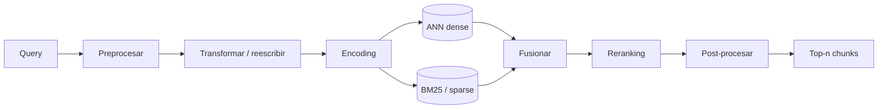

---
tags:
  - rag
  - rag/pipeline
  - rag/fase/retrieval
aliases:
  - Retrieval
  - RETRIEVAL
---
# Fase 2 · Retrieval

> [!info] Propósito
> Dada una pregunta, producir un ranking corto y preciso de chunks relevantes, priorizando no perder el bueno antes que descartar el malo.

> [!tip] Analogía dev
> Es el SELECT de la pregunta: primero un filtro amplio y barato (recall), después un ORDER BY caro y preciso (reranking).

## Diagrama de la fase

## Contrato de entrada y salida

> [!info] Entrada — Query del usuario
> - Texto de la pregunta
> - Historial de conversación (opcional)
> - tenant_id / ACL y filtros
> - Idioma y preferencias

> [!success] Salida — Top-n chunks
> - Texto del chunk (y del padre si aplica)
> - Score y posición en el ranking
> - Metadata y procedencia
> - Trazabilidad para auditar

## Salida en detalle

La salida es un ranking, no una lista de textos sueltos. Cada campo existe para que AUGMENTED decida qué entra al prompt y para que puedas auditar por qué.

### Texto del chunk

`chunk · parent`

El contenido que se va a insertar en el prompt. Si se usa parent-document, se incluye también el texto del padre para dar más contexto.

- **Función**: Es la materia prima de la respuesta: sin texto no hay nada que aumentar.
- **Conecta con**: AUGMENTED lo formatea y lo recorta según el presupuesto de tokens.

> [!tip] Analogía dev
> Como el resultado de un SELECT: primero traés la fila y después decidís qué columnas mostrar.

### Score y posición

`score · rank`

El número con el que el retriever ordenó cada candidato y su posición final después del reranking.

- **Función**: Permite decidir qué chunks entran, cuáles se descartan y en qué orden. Un score alto no garantiza que el chunk responda la pregunta.
- **Conecta con**: AUGMENTED usa el orden para poner lo mejor al principio y al final del contexto, donde el modelo presta más atención.

> [!tip] Analogía dev
> Como el ORDER BY de una consulta: el orden cambia lo que el usuario ve primero.

### Metadata y procedencia

`doc_id · página · ACL`

Los datos que identifican de dónde salió el chunk: documento, sección, página, tenant y permisos.

- **Función**: Permite filtrar antes de buscar, citar después y auditar siempre. Sin metadata no hay citas verificables ni aislamiento entre clientes.
- **Conecta con**: AUGMENTED construye el citations_map y GENERATION lo usa para citar.

> [!tip] Analogía dev
> Como la foreign key y el audit log: sin ellos no podés reconstruir el origen.

### Trazabilidad

`trace · candidatos · filtros`

El registro de qué query se buscó, con qué filtros, qué candidatos aparecieron y con qué scores.

- **Función**: Sirve para depurar: si la respuesta falla, podés ver si el problema fue la query, el filtro, el índice o el ranking.
- **Conecta con**: AUGMENTED y GENERATION agregan sus propias trazas para cerrar el recorrido completo.

> [!tip] Analogía dev
> Como los logs estructurados de un request: sin trazas, debuggeás a ciegas.

## Pasos

### 01 · Preprocesamiento de query

Normalizar (lowercase, Unicode), detectar idioma, corregir ortografía y extraer entidades o filtros (fechas, producto, tenant) para el WHERE.

`Normalización Unicode` · `Language detection` · `NER / extracción de filtros` · `Spell correction`

> [!tip] Tip
> Un filtro mal extraído puede vaciar el top-k aunque el índice esté perfecto.

### 02 · Transformación de query (pre-retrieval)

Reescribir la query usando el historial, expandir sinónimos y siglas, generar variantes, descomponer preguntas multi-hop o enrutar a otro índice. Acá se separa un RAG avanzado de uno naive.

`Query rewriting · LLM` · `Query expansion · sinónimos / PRF` · `HyDE · documento hipotético` · `Multi-query · N variantes` · `Decomposition · sub-preguntas` · `Step-back · pregunta general primero` · `Routing · elegir índice o herramienta`

> [!tip] Tip
> «¿Y eso cuánto sale?» no es una query: sin rewriting contra el historial, el retrieval no tiene chance.

### 03 · Encoding de la query

Embeddear la query con el mismo modelo de la fase 1 y el prefijo correcto (query: ...). Un mismatch de prefijo es una causa clásica de recall bajo.

`Bi-encoder · mismo modelo que el índice` · `Prefijo query / passage` · `Normalización L2`

> [!tip] Tip
> El prefijo no es opcional: E5 y BGE fueron entrenados con él.

### 04 · Candidate generation (stage 1)

Traer muchos candidatos (k = 50–200) con búsqueda densa, léxica o híbrida. Es la etapa orientada a recall: mejor traer de más que perder el correcto.

`Dense · HNSW / IVF / PQ` · `Sparse · BM25 / SPLADE` · `Hybrid · RRF o score fusion` · `Filtered ANN · metadata filtering` · `ColBERT · MaxSim multi-vector`

> [!tip] Tip
> Filtrar después del ANN puede dejar el top-k vacío o irrelevante. El filtered ANN es un problema no trivial.

### 05 · Reranking (stage 2)

Reordenar el top-K con un modelo que ve query y documento juntos. Es más caro (O(k)) pero mucho más preciso. Salida típica: top 3–10.

`Cross-encoder · BERT / RoBERTa` · `monoT5 · bge-reranker` · `Cohere Rerank` · `Listwise / LLM reranker`

> [!tip] Tip
> Patrón clásico de IR: recall barato a escala, precisión cara sobre pocos.

### 06 · Post-procesamiento del contexto

Deduplicar, diversificar con MMR, comprimir, cortar por umbral y expandir al padre o a las oraciones vecinas. Lo que sale de acá entra directo a la fase 3.

`Deduplicación por hash` · `MMR · diversidad` · `Compresión extractiva` · `LLMLingua · poda por perplejidad` · `Score threshold` · `Small-to-big / sentence window`

> [!tip] Tip
> Si nada supera el umbral, es mejor devolver «no encontré» que pasar ruido al generador.

### 07 · Iteración (opcional)

En preguntas multi-hop o cuando la confianza es baja, el sistema puede volver a recuperar: FLARE, Self-RAG, CRAG o un bucle agéntico tipo ReAct.

`FLARE · recuperar si baja la confianza` · `Self-RAG · decidir si recuperar` · `CRAG · evaluar y hacer fallback` · `Agentic multi-hop · ReAct`

> [!tip] Tip
> Iterar sin criterio de corte es una forma cara de loop infinito.

## Algoritmos

| Algoritmo | Rol | Qué hace |
| --- | --- | --- |
| HNSW / IVF | ANN · candidate generation | Búsqueda aproximada sobre vectores; recall ajustable por efSearch / nprobe. |
| BM25 | Léxico | Score por frecuencia e IDF; excelente para siglas, códigos y nombres propios. |
| RRF (Reciprocal Rank Fusion) | Fusión híbrida | Combina rankings con 1/(k + rank); no requiere calibrar escalas. |
| Cross-encoder | Reranking | Puntúa query y documento juntos; preciso pero O(k). |
| MMR | Diversidad | Penaliza chunks parecidos entre sí; evita cinco copias del mismo párrafo. |
| HyDE | Query transform | Genera una respuesta hipotética y embeddea eso como query. |
| Query decomposition | Multi-hop | Parte la pregunta en sub-preguntas resolubles por separado. |
| ColBERT | Multi-vector | Un vector por token con MaxSim; punto medio entre bi-encoder y cross-encoder. |
| Self-RAG / CRAG | Evaluación y fallback | Deciden si recuperar o corrigen el retrieval cuando la calidad es baja. |

## Entrenamiento del retriever

El retriever naive usa embeddings preentrenados que no saben nada de tu dominio. El retriever diferenciable se entrena con pares query-documento y, en el paper original de RAG, con el gradiente que viene del generador.

### Bi-encoder dual

- **Cómo**: Dos encoders: uno para query y otro para documento.
- **Cuándo**: Default de producción.
- **Tradeoff**: Documentos precomputados; la query se encodea al vuelo.

### InfoNCE / contraste

- **Cómo**: Softmax sobre un positivo y muchos negativos.
- **Cuándo**: Entrenamiento base.
- **Tradeoff**: Batch grande = más negativos = mejor contraste.

### In-batch negatives

- **Cómo**: Los positivos de otras queries del batch sirven de negativos.
- **Cuándo**: Siempre.
- **Tradeoff**: Gratis y efectivo; puede haber falsos negativos.

### Hard negatives

- **Cómo**: Negativos parecidos pero incorrectos, extraídos con BM25 o con el retriever.
- **Cuándo**: Cuando el recall se estanca.
- **Tradeoff**: Es lo que más mueve la aguja; riesgo de sesgo.

### RAG-Sequence

- **Cómo**: Un documento para toda la respuesta; se marginaliza sobre el top-k.
- **Cuándo**: Respuestas cortas y coherentes.
- **Tradeoff**: Gradiente fluye del generador al retriever.

### RAG-Token

- **Cómo**: Marginalización por token: cada token puede usar un documento distinto.
- **Cuándo**: Respuestas largas y multi-fuente.
- **Tradeoff**: Más flexible; más costo.

### REALM

- **Cómo**: Índice asíncrono + Expectation-Maximization.
- **Cuándo**: Entrenamiento a gran escala.
- **Tradeoff**: Complejo de implementar.

### Destilación cross-encoder

- **Cómo**: Un cross-encoder puntúa pares y el bi-encoder aprende de esas scores.
- **Cuándo**: Embedders modernos.
- **Tradeoff**: Muy buena calidad; pipeline de training más largo.

> [!important] Idea central
> La idea central del paper: el retriever no aprende a traer lo más parecido, aprende a traer lo que hace que el generador acierte.

## Estrategias

### Dense

Similitud coseno sobre embeddings.

- **Cuándo usarla**: Lenguaje natural, paráfrasis.
- **Tradeoff**: Semántica fuerte; flojo con códigos y siglas.

### Sparse

BM25 o SPLADE sobre términos.

- **Cuándo usarla**: Nombres propios, códigos, jerga exacta.
- **Tradeoff**: Exacto; no entiende sinónimos.

### Hybrid

Denso + léxico fusionados con RRF.

- **Cuándo usarla**: Producción general.
- **Tradeoff**: Mejor recall; más infraestructura.

### Multi-vector

ColBERT con MaxSim.

- **Cuándo usarla**: Máxima precisión.
- **Tradeoff**: Mucho más storage y cómputo.

### Hierarchical

Documento → sección → chunk.

- **Cuándo usarla**: Documentos largos y estructurados.
- **Tradeoff**: Varias etapas; más latencia.

### Two-stage

ANN top-100 → cross-encoder top-5.

- **Cuándo usarla**: Default de calidad.
- **Tradeoff**: El estándar; cuesta el rerank.

## Hiperparámetros

| Hiperparámetro | Valor típico | Efecto |
| --- | --- | --- |
| k (candidatos) | 50–200 | Más k = más recall y más costo de rerank. |
| efSearch | 50–200 | Más alto = más recall en HNSW y más latencia. |
| nprobe | 8–32 | Más clusters visitados = más recall en IVF. |
| RRF k | 60 | Suaviza la fusión de rankings. |
| MMR lambda | 0.5–0.7 | Más alto = más relevancia; más bajo = más diversidad. |
| rerank top-n | 3–10 | Cuántos chunks pasan a la fase 3. |
| score threshold | depende del modelo | Corta ruido; calibrar con datos reales. |

## Fallas

- **Vocabulary mismatch** — La pregunta usa palabras que no aparecen en el documento.
- **Domain gap** — El embedder no representa tu dominio.
- **Error de aproximación ANN** — efSearch o nprobe demasiado bajos.
- **Filter-induced recall loss** — El filtro de metadata deja fuera el chunk correcto.
- **k demasiado chico** — El bueno no entra al top-k.
- **Sesgo léxico o semántico** — Un solo canal domina la fusión.
- **Query ambigua** — Sin rewriting ni historial, se busca otra cosa.
- **Similitud ≠ relevancia** — Un chunk topicalmente parecido puede no responder la pregunta.
- **Índice stale** — Se busca en una versión vieja del corpus.

## Métricas

- **Recall@k** — ¿El chunk correcto está entre los k primeros?
- **Precision@k** — De los k recuperados, cuántos son relevantes.
- **MRR** — Posición del primer resultado relevante.
- **nDCG** — Calidad del orden completo del ranking.
- **Hit rate** — Porcentaje de queries con al menos un acierto.

---

← [[03 - Chunking|Chunking]] · [[05 - Augmented|Augmented]] →
