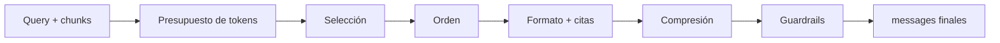

---
tags:
  - rag
  - rag/pipeline
  - rag/fase/augmented
aliases:
  - Augmented
  - AUGMENTED
---
# Fase 3 · Augmented

> [!info] Propósito
> Convertir (query, chunks) en un prompt óptimo para el LLM: asignar presupuesto de tokens, ordenar, formatear y defenderse de input malicioso.

> [!tip] Analogía dev
> Es armar los argumentos de la función y validar el contrato: no concatenás strings, asignás un presupuesto y defendés el input.

## Diagrama de la fase

## Contrato de entrada y salida

> [!info] Entrada — Query + chunks
> - Query (eventualmente reescrita)
> - Top-n chunks con score y metadata
> - Historial de conversación
> - Configuración de citas y presupuesto

> [!success] Salida — Prompt final
> - messages: system + user
> - citations_map: doc_id → fuente
> - token_count y presupuesto usado
> - trace: chunks usados y descartados

## Salida en detalle

La salida es el input exacto del LLM. No es «un prompt» genérico: es un contrato con rol, evidencia, presupuesto y un mapa de citas.

### messages

`system · user`

La estructura de mensajes que recibe el modelo. system define rol, reglas y formato; user lleva la pregunta y el contexto recuperado.

- **Función**: Separa instrucciones de evidencia. Es la base del instruction hierarchy y de la defensa contra prompt injection.
- **Conecta con**: GENERATION lo consume tal cual; no vuelve a armar el contexto.

> [!tip] Analogía dev
> Como separar configuración de argumentos en una función: no mezclás flags con datos.

### citations_map

`doc_id → fuente`

Un mapa que conecta cada fragmento insertado con su documento, página y quote original.

- **Función**: Permite que la respuesta cite fuentes verificables y que puedas rastrear cada afirmación.
- **Conecta con**: GENERATION lo usa para emitir citations y marcar grounded.

> [!tip] Analogía dev
> Como una tabla de referencias: cada dato apunta a su origen.

### Token count y presupuesto

`tokens · budget`

Cuántos tokens ocupa el prompt final y cuánto del presupuesto asignado se usó.

- **Función**: Controla costo, latencia y truncamiento. Si te pasás, el modelo corta el final o falla.
- **Conecta con**: GENERATION hereda ese presupuesto; si falta espacio, se recortan chunks antes de llamar al modelo.

> [!tip] Analogía dev
> Como el límite de payload de una API: si lo superás, el request se rechaza o se corta.

### Trace de contexto

`usados · descartados`

El registro de qué chunks entraron, cuáles quedaron afuera y por qué: score, presupuesto, deduplicación o filtro.

- **Función**: Explica la decisión de contexto y permite mejorar retrieval y augmentation con evidencia.
- **Conecta con**: GENERATION lo adjunta al trace final para auditoría.

> [!tip] Analogía dev
> Como el diff de un build: sabés qué entró y qué se descartó.

## Pasos

### 01 · Selección y presupuesto de tokens

Calcular el budget: ventana del modelo menos prompt de sistema, salida esperada y margen. Contar con el tokenizador del LLM (tiktoken), no con el del embedder. Seleccionar los mejores chunks que entren.

`tiktoken · conteo de tokens` · `Greedy por score` · `Knapsack con costos heterogéneos` · `MMR · selección diversa`

> [!tip] Tip
> El tokenizador del embedder y el del LLM no coinciden. Contar con el equivocado te hace overflow.

### 02 · Ordenamiento

Los LLM atienden más al inicio y al final del contexto (lost in the middle). Poner los mejores chunks en los extremos, agrupar por fuente y respetar el orden lógico dentro de cada documento.

`Best-first en extremos` · `Agrupación por documento` · `Orden narrativo / por sección`

> [!tip] Tip
> Meter el mejor chunk en el medio es regalarlo.

### 03 · Formateo del contexto

Delimitar cada documento con tags claros y numerados, inyectar metadata útil (título, sección, fecha) y marcar el contenido como datos, no como instrucciones.

`Tags XML / delimitadores` · `Numeración para citas` · `Metadata inline` · `Spotlighting / datamarking`

> [!tip] Tip
> Un delimitador claro también ayuda al modelo a citar correctamente.

### 04 · Construcción del prompt (4 capas)

System prompt con rol y reglas duras; contexto; mensaje del usuario; instrucciones de formato. Las reglas críticas: responder solo con el contexto, decir «no tengo esa información» si no está, y citar el doc_id.

`System prompt · rol y restricciones` · `Few-shot examples` · `JSON schema / formato de salida` · `Citation instructions`

> [!tip] Tip
> Una instrucción de abstención explícita reduce alucinaciones más que cualquier temperatura baja.

### 05 · Compresión

Reducir tokens sin perder la señal: poda extractiva de oraciones, resumen abstractivo con un modelo chico, o LLMLingua por perplejidad.

`Compresión extractiva · similitud / NLI` · `Resumen abstractivo` · `LLMLingua / LongLLMLingua`

> [!tip] Tip
> Comprimir de más borra justo el detalle que hacía falta. Medí faithfulness después.

### 06 · Guardrails

Jerarquía de instrucciones (system > user > datos), sanitización del contenido recuperado, redacción de PII y enforcement de ACL como defensa en profundidad.

`Instruction hierarchy` · `Detección de prompt injection` · `PII redaction` · `ACL enforcement`

> [!tip] Tip
> Un documento puede traer «ignorá lo anterior». El contenido recuperado es input no confiable.

## Algoritmos

| Algoritmo | Rol | Qué hace |
| --- | --- | --- |
| tiktoken | Token counting | Cuenta tokens con el tokenizador real del modelo; base del budgeting. |
| MMR / knapsack | Selección de contexto | Elige chunks diversos o maximiza utilidad bajo un presupuesto. |
| LLMLingua | Compresión | Poda tokens por perplejidad; compresión agresiva con pérdida controlada. |
| Spotlighting | Defensa | Marca el contenido recuperado como datos, no como instrucciones. |
| Instruction hierarchy | Defensa | Define prioridad entre system, user y contenido recuperado. |
| JSON schema | Formato | Fuerza una salida parseable y validable. |
| NLI / similarity | Compresión extractiva | Selecciona las oraciones que realmente sostienen la respuesta. |

## Estrategias

### Best-at-edges

Mejores chunks al inicio y al final.

- **Cuándo usarla**: Contextos largos.
- **Tradeoff**: Mitiga lost in the middle sin costo.

### Group-by-source

Agrupa chunks del mismo documento.

- **Cuándo usarla**: Múltiples documentos.
- **Tradeoff**: Mejor coherencia; puede desplazar el mejor chunk.

### Quote-first

Pedir citas textuales antes de responder.

- **Cuándo usarla**: Alta exigencia de fidelidad.
- **Tradeoff**: Más tokens y latencia.

### Abstention rule

Instrucción explícita de decir «no sé».

- **Cuándo usarla**: Siempre.
- **Tradeoff**: Puede abstenerse de más si el contexto es pobre.

### Compression

Poda o resumen del contexto.

- **Cuándo usarla**: Ventanas chicas o costo alto.
- **Tradeoff**: Riesgo de borrar el dato clave.

### Spotlighting

Delimitar y marcar datos.

- **Cuándo usarla**: Input externo no confiable.
- **Tradeoff**: No es infalible; suma tokens.

## Hiperparámetros

| Hiperparámetro | Valor típico | Efecto |
| --- | --- | --- |
| token budget | 40–70% de la ventana | Más contexto = más señal, pero también más ruido y costo. |
| top-n al prompt | 3–10 | Cuántos chunks entran realmente. |
| orden | best-at-edges | Mitiga el sesgo posicional del modelo. |
| compression ratio | 2–5x | Más compresión = menos costo y más riesgo de pérdida. |
| citation mode | inline / quote | Trazabilidad y verificabilidad. |
| abstention | explícita | Reduce alucinaciones; calibra el umbral. |

## Fallas

- **Context overflow** — El prompt no entra en la ventana y se trunca.
- **Lost in the middle** — El dato clave queda en el medio y el modelo lo ignora.
- **Redundancia** — Cinco chunks dicen lo mismo y gastan presupuesto.
- **Contexto contradictorio** — Dos fuentes dicen cosas distintas y el modelo elige mal.
- **Prompt injection indirecta** — Un documento trae instrucciones maliciosas.
- **Conflicto de instrucciones** — El contenido compite con el system prompt.
- **Citas mal mapeadas** — El doc_id citado no contiene la afirmación.
- **Fuga por ACL** — Un chunk no autorizado llega al prompt.

## Métricas

- **Context relevance** — ¿El contexto ensamblado sirve para responder?
- **Context precision** — ¿Los chunks útiles están arriba en el contexto?
- **Token efficiency** — Tokens útiles contra tokens totales del prompt.
- **Discard rate** — Cuánto del top-n se descarta por presupuesto.

---

← [[04 - Retrieval|Retrieval]] · [[06 - Generation|Generation]] →
