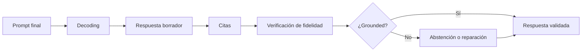

---
tags:
  - rag
  - rag/pipeline
  - rag/fase/generation
aliases:
  - Generation
  - GENERATION
---
# Fase 4 · Generation

> [!info] Propósito
> Producir una respuesta fiel al contexto, con citas y trazabilidad, y validarla antes de devolverla.

> [!tip] Analogía dev
> Es el return tipado con validación: el contrato dice que solo podés devolver datos del contexto, y hay un test que lo verifica antes de responder.

## Diagrama de la fase

## Contrato de entrada y salida

> [!info] Entrada — Prompt final
> - messages: system + user
> - citations_map y metadata
> - trace de chunks usados
> - Configuración de decoding

> [!success] Salida — Respuesta validada
> - answer
> - citations con doc_id, página y quote
> - grounded: true / false
> - confidence y trace completo

## Salida en detalle

La salida no es solo texto: es una respuesta con evidencia, un veredicto de grounding y la traza para auditarla. Si falta cualquiera de esos campos, el contrato se rompe.

### Answer

`texto final`

La respuesta en lenguaje natural que ve el usuario.

- **Función**: Es el objetivo del pipeline, pero no alcanza por sí sola: necesita citas y verificación.
- **Conecta con**: Se devuelve al usuario o a la aplicación que la consuma.

> [!tip] Analogía dev
> Como el return de una función: el valor que sale del sistema.

### Citations

`doc_id · página · quote`

Las fuentes exactas que respaldan cada afirmación, con el fragmento textual que la soporta.

- **Función**: Hacen verificable la respuesta y permiten al usuario abrir la fuente.
- **Conecta con**: Se construyen desde el citations_map de AUGMENTED y se validan contra los chunks usados.

> [!tip] Analogía dev
> Como los tests que respaldan un cambio: sin evidencia, no hay confianza.

### Grounded

`true / false`

Un veredicto sobre si la respuesta está soportada por el contexto recuperado.

- **Función**: Si es false, el sistema debería abstenerse, reparar o marcar la respuesta como no confiable.
- **Conecta con**: Alimenta la decisión de abstención y las métricas de faithfulness.

> [!tip] Analogía dev
> Como el resultado de una validación: pass/fail antes de devolver.

### Confidence y trace

`confidence · trace`

Un indicador de confianza y el recorrido completo: query, chunks, prompt, respuesta y verificación.

- **Función**: Permite monitorear, auditar y reproducir por qué el sistema respondió eso.
- **Conecta con**: Cierra el contrato y alimenta observabilidad, feedback y evaluación.

> [!tip] Analogía dev
> Como el request ID y los logs: sin eso no podés investigar un incidente.

## Pasos

### 01 · Inferencia y decoding

El modelo decoder-only genera la respuesta condicionada al contexto. Para tareas factuales conviene baja temperatura; para formato estricto, constrained decoding.

`Transformer decoder` · `Greedy / beam search` · `Sampling · temperature, top-p, top-k, min-p` · `Repetition penalty` · `Constrained decoding · GBNF / regex / JSON schema`

> [!tip] Tip
> Temperatura alta en RAG factual es una fábrica de variaciones creativas de la verdad.

### 02 · Atribución y citas

Pedir citas inline o quotes y mapearlas a los chunks. La atribución post-hoc alinea cada afirmación con su fuente a nivel de oración.

`Inline citation [doc_id]` · `Quote extraction` · `Sentence-level attribution` · `Citation verification`

> [!tip] Tip
> Una cita que no contiene la afirmación es peor que no citar: da falsa confianza.

### 03 · Verificación de fidelidad

Antes de devolver, chequear que cada afirmación esté implicada por el contexto. Se puede hacer con un modelo NLI, con un LLM juez, o con ambos.

`NLI · DeBERTa-MNLI` · `LLM-as-a-judge · claim decomposition` · `RAGAS faithfulness` · `Schema validation`

> [!tip] Tip
> Descomponer en claims y verificar uno por uno es más robusto que pedir «¿es fiel?» de una.

### 04 · Repair / abstención

Si la fidelidad es baja, regenerar con instrucción más estricta, podar la afirmación no soportada, o abstenerse. Abstenerse bien es una feature, no un fallo.

`Repair loop con umbral` · `Claim pruning` · `Abstención explícita` · `Re-retrieval · CRAG / Self-RAG`

> [!tip] Tip
> Un «no tengo esa información» correcto vale más que una respuesta inventada.

### 05 · Ensamblado final

Devolver respuesta, citas, flag de grounded, confianza y trace. El trace permite auditar, evaluar y depurar el sistema después.

`Response assembly` · `Confidence scoring` · `Trace logging` · `PII / toxicity filters`

> [!tip] Tip
> Sin trace no podés diagnosticar por fase; solo ves el resultado final.

## Algoritmos

| Algoritmo | Rol | Qué hace |
| --- | --- | --- |
| Transformer decoder | Generación | Modelo autorregresivo; el contexto entra en la ventana de atención. |
| Greedy / beam | Decoding determinista | Reproducible; bueno para datos factuales. |
| Top-p / top-k / min-p | Sampling | Controla diversidad; en RAG factual conviene bajo. |
| Constrained decoding | Formato | Gramática o schema garantiza salida parseable. |
| DeBERTa-MNLI | Verificación NLI | Chequea si el contexto implica cada afirmación. |
| LLM-as-a-judge | Verificación | Descompone en claims y evalúa fidelidad y relevancia. |
| RAGAS | Evaluación | Faithfulness, answer relevance, context precision y recall. |
| CRAG / Self-RAG | Repair loop | Disparan re-retrieval o abstención según la calidad. |

## Estrategias

### Low temperature

Temperatura cercana a 0.

- **Cuándo usarla**: Datos factuales.
- **Tradeoff**: Menos variedad; más repetitivo.

### Quote-then-answer

Primero extrae citas, después responde.

- **Cuándo usarla**: Alta exigencia de fidelidad.
- **Tradeoff**: Más tokens y latencia.

### Schema-constrained

Salida JSON validada.

- **Cuándo usarla**: Integración con sistemas.
- **Tradeoff**: Rígido; puede forzar formato sobre contenido.

### Self-check

Verificar claims contra el contexto.

- **Cuándo usarla**: Producción.
- **Tradeoff**: Costo extra por respuesta.

### Abstention

No responder si no hay soporte.

- **Cuándo usarla**: Siempre.
- **Tradeoff**: Calibrar el umbral para no abstenerte de más.

### Repair loop

Regenerar o podar claims no soportados.

- **Cuándo usarla**: Faithfulness baja.
- **Tradeoff**: Latencia y costo.

## Hiperparámetros

| Hiperparámetro | Valor típico | Efecto |
| --- | --- | --- |
| temperature | 0–0.2 | Baja = determinismo y fidelidad; alta = creatividad. |
| top_p | 0.9–1.0 | Recorta la cola de probabilidad. |
| max_tokens | según caso | Limita costo y latencia. |
| citation mode | inline | Trazabilidad por afirmación. |
| faithfulness threshold | 0.8–0.9 | Dispara repair o abstención. |
| repair attempts | 1–2 | Más intentos = más costo; rendimientos decrecientes. |

## Fallas

- **Alucinación pese al contexto** — El modelo inventa aunque el dato esté disponible.
- **Prior sobre contexto** — Impone conocimiento viejo y contradice la fuente.
- **Sobre-resumen** — Pierde el detalle exacto que se preguntaba.
- **Cita incorrecta** — El doc_id citado no contiene la afirmación.
- **Chunks contradictorios** — Dos fuentes discrepan y el modelo elige mal.
- **Degradación en contexto largo** — La señal se diluye y baja la calidad.
- **Obediencia a injection** — Sigue instrucciones embebidas en un documento.
- **Abstención mal calibrada** — Se abstiene cuando sí sabía, o responde cuando no.

## Métricas

- **Faithfulness** — ¿La respuesta se sostiene en el contexto? Claim por claim.
- **Answer relevance** — ¿Responde lo que se preguntó?
- **Answer correctness** — ¿Coincide con la respuesta de referencia?
- **Citation accuracy** — ¿La cita contiene realmente la afirmación?
- **Abstention correctness** — ¿Se abstiene cuando corresponde y solo entonces?
- **Alcance de RAGAS** — Faithfulness y answer relevance son reference-free; context recall y answer correctness requieren ground truth.

---

← [[05 - Augmented|Augmented]] · [[07 - Transversal|Transversal]] →
