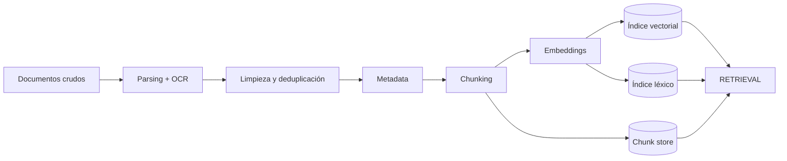
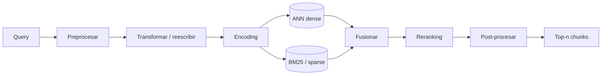
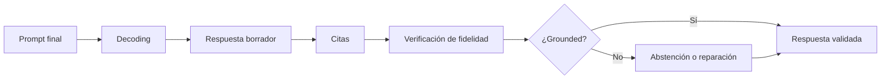

---
tags:
  - rag
  - rag/diagramas
aliases:
  - Diagramas
  - Pipeline RAG
---
# Diagramas

## Pipeline isométrico animado

![[pipeline-isometrico.svg]]

> [!note] Animación
> El SVG conserva la animación de los paquetes entre fases. Si tu versión de Obsidian no reproduce SMIL, se ve igual como diagrama estático.

## Versión PNG

![[pipeline-isometrico.png]]

## Pipeline en Mermaid

## Diagramas por fase

### Chunking

### Retrieval

### Augmented

### Generation

---

[[01 - Visión general|← Visión general]] · [[10 - Glosario|Glosario →]]
